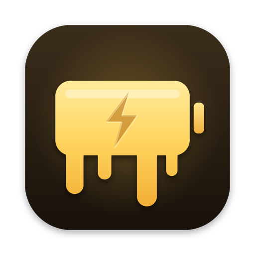
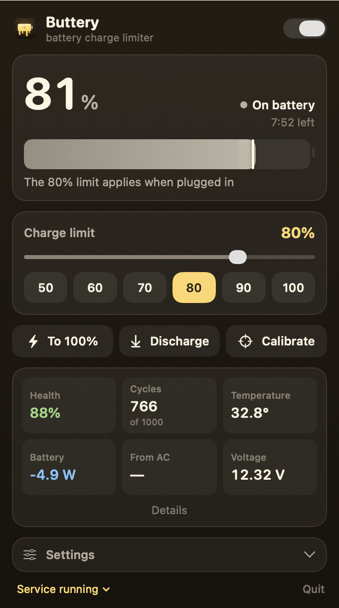

<p align="center">
  
</p>

<h1 align="center">Buttery</h1>

<p align="center">
  Battery charge limiter for the macOS menu bar.<br>
  Ограничитель заряда батареи в строке меню macOS.
</p>

<h3 align="center">
  <a href="#english">English</a> · <a href="#russian">Русский</a>
</h3>

<p align="center">
  
</p>

<a id="english"></a>

## English

A battery wears out faster when it sits at 100% all the time. Buttery stops charging at the limit you set and starts again once the charge drops.

### Features

- **Charge limit** from 20 to 100%.
- **Sailing**: don't recharge until the charge falls N% below the limit.
- **Discharge** to the limit on battery while the charger stays connected; **auto discharge** does it for you.
- **To 100%**: charge fully once.
- **Calibration**: discharge to 15% → charge to 100% → 1 hour at 100% → discharge to the limit.
- **Heat protection** and a choice of what happens during sleep.
- **MagSafe**: orange while charging, green at the limit, a blink when the limit is reached, off at night.
- Notifications, health, cycles, temperature, power and a 24-hour charge chart.
- English or Russian interface.

### Requirements

- Apple Silicon Mac.
- macOS 14 or later.
- Xcode or Command Line Tools to build.

### Install

Download the DMG from [Releases](https://github.com/ssaddist/buttery/releases) and drag Buttery to Applications. The app isn't signed with a developer certificate, so the first time you open it, right-click it and choose **Open**.

To build from source:

```bash
git clone https://github.com/ssaddist/buttery.git && cd buttery && ./build.sh --install
```

Other modes: `./build.sh` (build only), `--dmg` (installer image), `--test` (tests only), `--icon` (redraw the icon).

On first launch, click **Install** and enter your password. This installs the `butteryd` background service, which needs root to control charging.

Turn off Optimized Battery Charging in System Settings → Battery. Don't run Buttery alongside AlDente or other charge limiters.

### How it works

The app saves settings to `/Users/Shared/Buttery/config.json`. Every 2–5 seconds the `butteryd` service reads them, decides whether the Mac should charge, and writes the SMC keys:

| Task              | Keys                     |
| ----------------- | ------------------------ |
| stop charging     | `CHTE`, `CH0B` / `CH0C`  |
| disable adapter   | `CHIE`, `CH0I`, `CH0J`   |
| MagSafe light     | `ACLC`                   |

If the firmware can't stop charging (for example on macOS 27), the service holds the limit by disabling the adapter.

The service writes its status to `/Library/Application Support/Buttery/` and its log to `/var/log/butteryd.log`. To check its status without root:

```bash
/Applications/Buttery.app/Contents/Resources/butteryd --status
```

Code layout: `App/` is the interface, `Daemon/` the service, `Shared/Policy.swift` the charging logic, `Tests/` the tests.

### Uninstall

At the bottom of the window, click **Service running → Remove helper**. Then delete the app and the `/Users/Shared/Buttery` folder.

### Disclaimer

Apple provides no official way to control charging. Buttery writes to the SMC directly, and a macOS update may break it. Use at your own risk. If the service is stopped or removed, macOS takes back control of charging.

Not affiliated with Apple or AlDente.

### License

[MIT](LICENSE) © 2026 Aleksandr Kholin

---

<a id="russian"></a>

## Русский

Батарея изнашивается быстрее, если постоянно держать её на 100%. Buttery останавливает зарядку на заданном лимите и снова включает её, когда заряд опустится.

### Возможности

- **Лимит заряда** от 20 до 100%.
- **Плавание**: не подзаряжать, пока заряд не упадёт на N% ниже лимита.
- **Разрядить** до лимита от батареи, не отключая зарядку; **авторазряд** делает это сам.
- **До 100%**: однократно зарядить полностью.
- **Калибровка**: разряд до 15% → заряд до 100% → час на 100% → разряд до лимита.
- **Защита от перегрева** и настройка поведения во сне.
- **MagSafe**: оранжевый при зарядке, зелёный на лимите, мигание на лимите, выключение ночью.
- Уведомления, здоровье, циклы, температура, мощность и график заряда за 24 часа.
- Интерфейс на английском или русском.

### Требования

- Mac на Apple Silicon.
- macOS 14 или новее.
- Для сборки нужны Xcode или Command Line Tools.

### Установка

Скачайте DMG из [Releases](https://github.com/ssaddist/buttery/releases) и перетащите Buttery в «Программы». Приложение не подписано сертификатом разработчика, поэтому в первый раз откройте его так: правый клик → **Открыть**.

Сборка из исходников:

```bash
git clone https://github.com/ssaddist/buttery.git && cd buttery && ./build.sh --install
```

Другие режимы: `./build.sh` (только сборка), `--dmg` (установочный образ), `--test` (только тесты), `--icon` (перерисовать иконку).

При первом запуске нажмите **Install** и введите пароль: так устанавливается фоновая служба `butteryd`. Ей нужны права root, чтобы управлять зарядкой.

«Оптимизированную зарядку» в настройках батареи лучше выключить. Не запускайте Buttery вместе с AlDente или другими ограничителями заряда.

### Как это работает

Приложение записывает настройки в `/Users/Shared/Buttery/config.json`. Служба `butteryd` раз в 2–5 секунд читает их, решает, нужно ли заряжать, и пишет ключи SMC:

| Задача               | Ключи                    |
| -------------------- | ------------------------ |
| запрет зарядки       | `CHTE`, `CH0B` / `CH0C`  |
| отключение адаптера  | `CHIE`, `CH0I`, `CH0J`   |
| светодиод MagSafe    | `ACLC`                   |

Если прошивка не позволяет запретить зарядку (например, macOS 27), лимит держится через отключение адаптера.

Состояние службы она сама записывает в `/Library/Application Support/Buttery/`, а журнал — в `/var/log/butteryd.log`. Посмотреть состояние без прав root:

```bash
/Applications/Buttery.app/Contents/Resources/butteryd --status
```

Код: `App/` — интерфейс, `Daemon/` — служба, `Shared/Policy.swift` — логика зарядки, `Tests/` — тесты.

### Удаление

Внизу окна нажмите **Service running → Remove helper**. Потом удалите приложение и папку `/Users/Shared/Buttery`.

### Предупреждение

Apple не предоставляет официального способа управлять зарядкой. Buttery пишет напрямую в SMC, и после обновления macOS это может перестать работать. Используйте на свой риск. Если служба остановлена или удалена, зарядкой снова управляет macOS.

Проект не связан ни с Apple, ни с AlDente.

### Лицензия

[MIT](LICENSE) © 2026 Александр Холин
